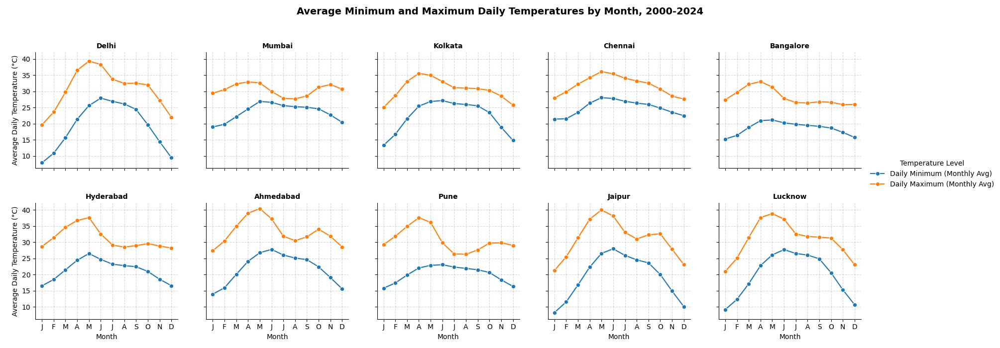
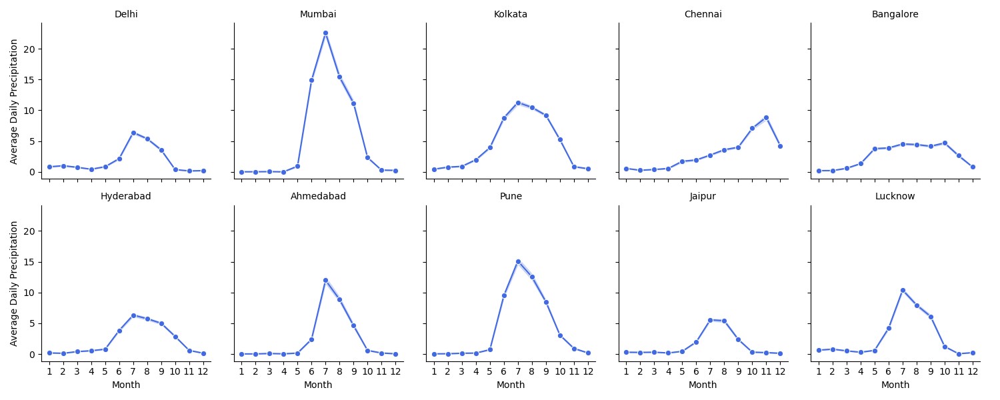
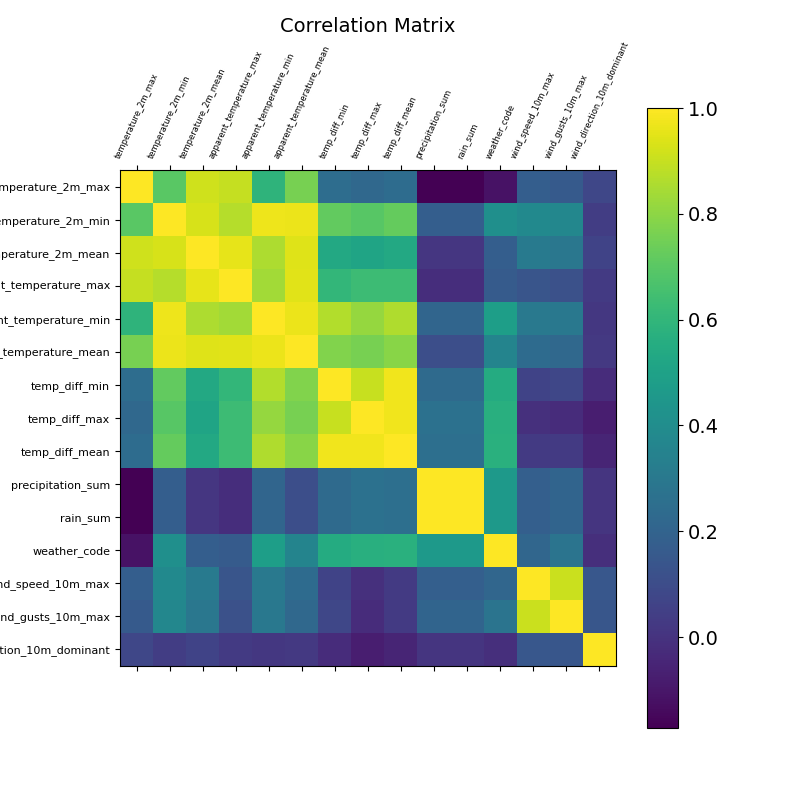
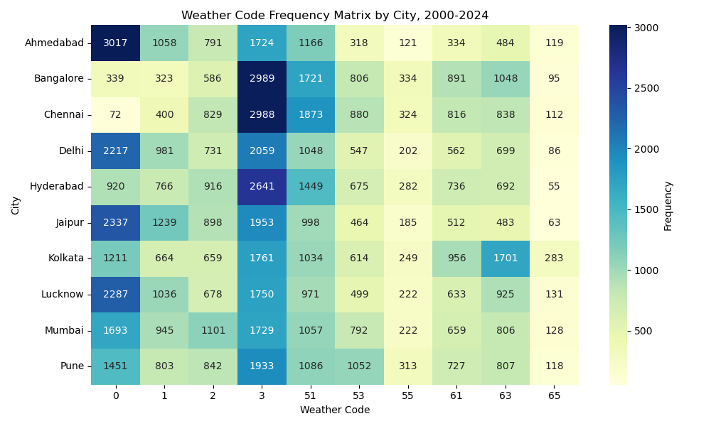

# India Weather 2000–2024: Exploratory Analysis

Exploratory and relationship analysis of 25 years of daily weather records from 10 major Indian cities.

## Overview

This project analyzes daily weather data from **10 Indian cities** between 1 January 2000 and 31 December 2024:
Ahmedabad, Bangalore, Chennai, Delhi, Hyderabad, Jaipur, Kolkata, Lucknow, Mumbai and Pune.

The data includes temperature, apparent ("feels like") temperature, precipitation and rain, wind and wind-gust speeds, wind direction, and a WMO weather code that describes each day's conditions.

The exploratory analysis has two aims: to identify typical weather patterns across the country, by region and by city, and to identify changes in weather conditions between 2000 and 2024.

**Part 1 (this repository)** covers the following steps:
- assessing the scope and quality of the dataset
- building a data dictionary
- descriptive and exploratory analysis at national and city level
- examining relationships between variables

## Key findings

### Climate patterns
- **Delhi and Jaipur** have the widest range of average daily temperatures across the year and the lowest precipitation.
- In every city except Chennai, precipitation peaks around **June–July**. Chennai peaks in **October–November**, which reflects the region's different monsoon.

### Relationships between variables
- **Rain and precipitation correlate almost perfectly**, as expected in a warm climate with no snow or sleet. Rain has the strongest correlation with weather code.
- **Wind direction** shows no meaningful correlation with any other variable or with the weather code.
- On **at least half of all days**, the weather code is 0–3, meaning no rain or precipitation.
- **Ahmedabad** has the most clear days (code 0) and **Chennai** the fewest. **Kolkata** has the most days of moderate and heavy rain (codes 63 and 65).
- **Heavy rain (code 65) was more frequent in 2024 than in 2012 in every city.** Ahmedabad also shows a shift from clear days toward cloudier, rainier days between 2000 and 2024.
- Rain correlates positively with the **gap between apparent and actual temperature**, which likely reflects humidity. Rain has a weaker positive correlation with wind speed and gusts.
- Higher wind speeds make **minimum temperatures feel colder** than they are. This cooling effect is weak.

## Visual highlights

<table>
  <tr>
    <td></td>
    <td></td>
  </tr>
  <tr>
    <td align="center"><em>Average monthly min/max temperatures by city</em></td>
    <td align="center"><em>Average monthly precipitation by city</em></td>
  </tr>
  <tr>
    <td></td>
    <td></td>
  </tr>
  <tr>
    <td align="center"><em>Correlation matrix of numeric variables</em></td>
    <td align="center"><em>Weather code frequency by city, 2000–2024</em></td>
  </tr>
</table>

More charts are in [`visualizations/`](visualizations/), organized by analysis step.

## Notebooks

Run the notebooks in this order:

| # | Notebook | Purpose |
|---|----------|---------|
| 1 | [data-prep-cleaning-EA-visualization](scripts/data-prep-cleaning-EA-visualization.ipynb) | Cleaning and completeness checks, derived columns, descriptive statistics, overall EDA |
| 2 | [detailed-eda-cities](scripts/detailed-eda-cities.ipynb) | Monthly averages for each city across all 25 years |
| 3 | [detailed-eda-years](scripts/detailed-eda-years.ipynb) | Daily values for all cities in 2000, 2012 and 2024 |
| 4 | [detailed-eda-temps](scripts/detailed-eda-temps.ipynb) | Difference between actual and apparent temperature, by city and by year |
| 5 | [exploring-relationships](scripts/exploring-relationships.ipynb) | Correlation matrix, weather-code frequency heatmaps, regression plots |

## Repository structure

```
india-weather/
├── data/
│   ├── india_2000_2024_daily_weather.csv   # raw data (Kaggle)
│   ├── daily_weather_updated.pkl           # cleaned data, written by notebook 1
│   └── daily_weather_updated_2.pkl         # + temperature differences, written by notebook 4
├── scripts/                                # Jupyter notebooks (see table above)
├── visualizations/
│   ├── initial_eda/                        # overall, by city, by year
│   ├── eda_individual_cities/              # one folder per city
│   ├── eda_individual_years/               # 2000, 2012, 2024
│   └── variable_relationships/             # correlation matrix, regression plots
└── reports/
    └── Interim Report.pdf
```

## How to run

1. Clone the repository and install the dependencies:
   ```bash
   pip install pandas==3.0.0 numpy==2.4.2 matplotlib==3.10.8 seaborn==0.13.2 jupyter
   ```
   The `.pkl` files were written with pandas 3.0.0. Other pandas versions may not load them correctly.
2. Open the notebooks from `scripts/`. `path` defaults to the repository root (`os.path.abspath('..')`), so you only need to change it if you run the notebooks from somewhere else. Data is read from and written to `data/`. Charts are saved to `visualizations/` with `save_fig`, which creates any missing folders.
3. The cleaned `.pkl` files are already included, so you can run any notebook without running the earlier ones first. Notebooks 2–4 read `daily_weather_updated.pkl`, which notebook 1 writes. Notebook 5 reads `daily_weather_updated_2.pkl`, which notebook 4 writes. If you re-run notebook 1, re-run notebook 4 before notebook 5.

## Data

**Sources**
- [Climate in India: daily weather data 2000–2024 (Kaggle)](https://www.kaggle.com/datasets/developerghost/climate-in-india-daily-weather-data-2000-2024/data)
- [WMO code table 4677: present weather (NOAA)](https://www.nodc.noaa.gov/archive/arc0021/0002199/1.1/data/0-data/HTML/WMO-CODE/WMO4677.HTM). This table was used to add text descriptions to the weather codes.

**Original columns**

| Column | Type | Description |
|--------|------|-------------|
| `city` | object | City where the weather was recorded |
| `date` | object | Date of record (YYYY-MM-DD) |
| `temperature_2m_max` / `_min` | float | Max / min temperature at 2 m height (°C) |
| `apparent_temperature_max` / `_min` | float | Max / min perceived (feels-like) temperature, affected by wind and humidity (°C) |
| `precipitation_sum` | float | Total daily precipitation (mm) |
| `rain_sum` | float | Total daily rainfall (mm) |
| `weather_code` | int | WMO weather interpretation code |
| `wind_speed_10m_max` | float | Max wind speed at 10 m height (km/h) |
| `wind_gusts_10m_max` | float | Max wind-gust speed at 10 m height (km/h) |
| `wind_direction_10m_dominant` | int | Dominant wind direction (degrees) |

**Key derived columns**

| Column | Derived from | Description |
|--------|--------------|-------------|
| `temperature_2m_mean`, `apparent_temperature_mean` | daily min and max | Mean of each day's min and max |
| `year`, `month`, `month_year` | `date` | Date parts used for aggregation |
| `temp_diff_min` / `_max` / `_mean` | apparent and actual temperatures | Apparent minus actual temperature (perceived difference) |
| `*_monthly_avg`, `temp_diff_*_monthly` | daily values, `month_year`, `city` | Monthly averages per city |
| `wmo_description` | `weather_code` | Text description of the WMO code |

The full data dictionary is in the [interim report](reports/Interim%20Report.pdf).

## Limitations

- The dataset has no humidity or cloud-cover data, which limits explanations of apparent-temperature differences.
- Rain data is heavily right-skewed, with many days of zero rain, which weakens the linear regression fits.
- Correlation does not imply causation. Weather codes are categories, so their correlations should be read with care.

## Next steps (Part 2)

Part 2 uses the data for **time-series forecasting** and **machine learning**. The forecasting model will be chosen based on the data's stationarity and seasonality, with SARIMA/SARIMAX as candidates. The machine-learning work will try to predict weather codes for each city. The aim is to identify trends over the 25-year period and make near-term predictions.

## Report

All Part 1 steps, visuals and insights are documented in the [Interim Report](reports/Interim%20Report.pdf).

---

*Built with Python (pandas, NumPy, Matplotlib, Seaborn) in Jupyter Notebook.*
